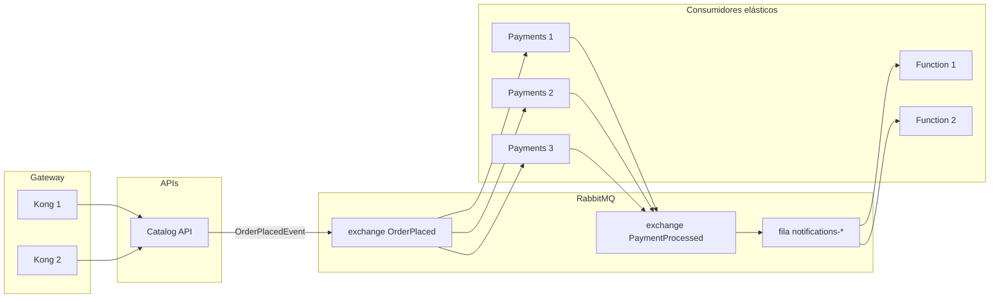

# Escalabilidade — FCG

Como cada parte da plataforma escala de forma independente, e como demonstrar isso.

---

## Onde cada componente escala

| Componente | Escala horizontal? | Por quê |
|---|---|---|
| **Kong** | Sim | Stateless em modo DB-less: cada réplica lê a mesma configuração declarativa |
| **Users API** | Sim | Stateless (JWT), banco próprio |
| **Catalog API** | Sim* | API stateless; MongoDB e Redis são compartilhados entre as réplicas |
| **Payments API** | Sim, ideal | Consumidor de fila; idempotência por `OrderId` |
| **Notifications Function** | Sim, por definição | O host de Functions só materializa a função quando há mensagem |
| **MongoDB** | Réplica/sharding em produção | Uma instância no ambiente local |
| **Redis** | Cluster em produção | Uma instância no ambiente local; falha é degradação, não queda |
| **RabbitMQ** | Cluster em produção | A fila distribui a carga entre os consumidores |

\* O SQLite do Catalog é local ao pod. Em produção, trocar por um banco relacional compartilhado (PostgreSQL, SQL Server). MongoDB e Redis já são compartilhados e não impedem múltiplas réplicas.



Cada réplica de **Payments** compete pela mesma fila: o RabbitMQ entrega cada mensagem a **um** consumidor, o que dá balanceamento de carga natural. O mesmo vale para as réplicas da função sobre as filas `notifications-*`.

---

## 1. Docker Compose — escalar consumidores

Nenhum microsserviço publica porta no host, então escalar não gera conflito e não precisa de overlay:

```powershell
docker compose up -d --scale payments-api=3 --scale notifications-function=2
docker compose ps
```

**Verificar:** <http://localhost:15672> → **Queues** → a coluna *consumers* sobe nas filas `OrderPlaced` e `notifications-*`.

**Testar:** dispare várias compras pelo gateway e acompanhe os logs — containers diferentes processam pedidos diferentes.

```powershell
docker compose logs payments-api --tail 50
docker compose logs notifications-function --tail 50
```

Voltar ao normal:

```powershell
docker compose up -d --scale payments-api=1 --scale notifications-function=1
```

---

## 2. Kubernetes — réplicas no Deployment

Users, Catalog e Payments já sobem com `replicas: 2`, e o Kong com 2. Para escalar mais:

```powershell
kubectl scale deployment catalog-api --replicas=3
kubectl scale deployment payments-api --replicas=3
kubectl get pods -l app=payments-api
```

O `Service` faz o balanceamento entre os pods automaticamente. Como o Prometheus descobre alvos por anotação de pod, **as réplicas novas entram na coleta sozinhas** — o dashboard passa a mostrar cada uma sem nenhuma mudança de configuração.

---

## 3. Kubernetes — HPA

Manifestos em [`k8s/scaling/`](k8s/scaling/):

| Arquivo | Alvo | Min | Max | Gatilho |
|---|---|---|---|---|
| `hpa-payments-api.yaml` | `payments-api` | 2 | 5 | CPU 70% |
| `hpa-notifications-function.yaml` | `notifications-function` | 1 | 5 | CPU 70%, janela de 120 s na redução |

**Pré-requisito:** `metrics-server` no cluster (o Kubernetes do Docker Desktop costuma incluir).

```powershell
kubectl apply -f k8s/scaling/
kubectl get hpa
```

Gerar carga e observar:

```powershell
kubectl run load-gen --image=busybox --restart=Never -- /bin/sh -c "while true; do wget -q -O- http://catalog-api/api/games; done"
kubectl get hpa -w
```

Limpar: `kubectl delete pod load-gen`.

### Escalar pela profundidade da fila

Para um consumidor de mensageria, CPU é um sinal indireto — o sinal certo é o tamanho da fila. Duas formas de chegar lá:

* **No cluster:** [KEDA](https://keda.sh) com o *scaler* de RabbitMQ, que lê a profundidade da fila e escala inclusive até zero réplicas.
* **Na Azure:** é o que o plano **Elastic Premium** faz nativamente com `functionsRuntimeScaleMonitoringEnabled`, já configurado em `fcg-notifications-function/infra/main.bicep`.

Os HPAs por CPU deste repositório rodam em qualquer cluster, sem instalar nada além do metrics-server.

---

## 4. Idempotência — o que torna o scale out seguro

Escalar consumidores só é seguro se a mesma mensagem processada duas vezes não causar efeito duplicado.

| Serviço | Proteção |
|---|---|
| **Payments** | Verifica `OrderId` já processado antes de publicar; chave primária em `ProcessedOrders.OrderId` |
| **Catalog** | `ConfirmPurchaseAsync` verifica se o jogo já está na biblioteca; chave composta (usuário, jogo) barra a duplicata |
| **Avaliações** | Índice único (gameId, usuarioId): a gravação é um upsert |

---

## 5. Cache e escala

O Redis é **compartilhado** entre as réplicas da Catalog API: o que uma réplica grava, as outras aproveitam. É a diferença entre cache distribuído e cache em memória — com cache local, cada réplica nova começaria fria e a taxa de acerto cairia à medida que a aplicação escala.

Isso é visível no painel **Acerto do cache** do Grafana ao escalar a Catalog API: a taxa se mantém, em vez de despencar.

---

## 6. Para o vídeo (30 segundos)

1. `docker compose up -d --scale payments-api=3` e depois `docker compose ps` — três réplicas.
2. RabbitMQ → **Queues** → `OrderPlaced` com 3 consumidores.
3. Disparar compras e mostrar containers diferentes nos logs.
4. No Kubernetes: `kubectl get hpa` e `kubectl get pods`.
