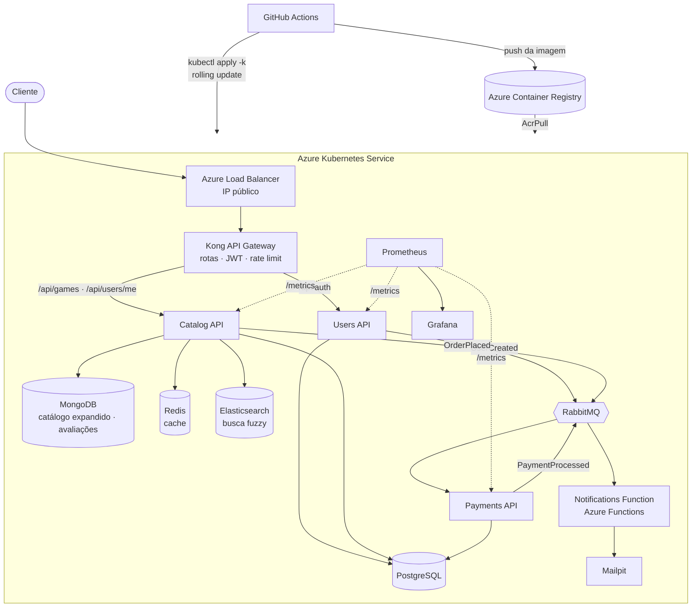

# FIAP Cloud Games — Tech Challenge Fase 4

[](https://github.com/LMXSS/TC4/actions/workflows/platform.yml)
[](https://github.com/LMXSS/TC4/actions/workflows/users-api.yml)
[](https://github.com/LMXSS/TC4/actions/workflows/catalog-api.yml)
[](https://github.com/LMXSS/TC4/actions/workflows/payments-api.yml)
[](https://github.com/LMXSS/TC4/actions/workflows/notifications-function.yml)

**Pós Tech FIAP — Arquitetura de Sistemas .NET.** A FIAP Cloud Games (FCG) é uma plataforma de venda de jogos em microsserviços .NET 8. Nesta fase ela passa a rodar num **Kubernetes gerenciado na Azure (AKS)**, com **deploy contínuo pelo GitHub Actions**, **busca avançada com Elasticsearch**, **MongoDB** e **cache no Redis**, e **nenhuma credencial em código ou YAML**.

> **Por onde começar:** este README dá a visão geral. O guia completo de arquitetura, deploy e operação está em [`fcg-platform/README.md`](fcg-platform/README.md).

---

## Sumário

1. [O desafio e como foi atendido](#o-desafio-e-como-foi-atendido)
2. [Arquitetura](#arquitetura)
3. [Organização do repositório](#organização-do-repositório)
4. [Pipelines de CI/CD](#pipelines-de-cicd)
5. [Como executar](#como-executar)
6. [Documentação](#documentação)
7. [Tecnologias](#tecnologias)
8. [Equipe](#equipe)

---

## O desafio e como foi atendido

| Requisito da Fase 4 | Solução | Onde ver |
|---|---|---|
| **Kubernetes gerenciado na nuvem** | AKS (2 nós), provisionado por Bicep | [`fcg-platform/infra/azure/main.bicep`](fcg-platform/infra/azure/main.bicep) |
| **Registry privado nativo** | Azure Container Registry, sem usuário admin; o AKS puxa por identidade gerenciada | [`main.bicep`](fcg-platform/infra/azure/main.bicep) |
| **Exposição externa** | Kong API Gateway num Service `LoadBalancer` → Azure Load Balancer com IP público | [`k8s/gateway/kong.yaml`](fcg-platform/k8s/gateway/kong.yaml) |
| **NoSQL** (MongoDB ou DynamoDB) | **MongoDB** com `MongoDB.Driver`: catálogo expandido e avaliações | [`Catalog.Api/Infrastructure/Mongo`](fcg-catalog-api/Catalog.Api/Infrastructure/Mongo) |
| **Cache distribuído** | **Redis** com `IDistributedCache`: listagens, detalhes, avaliações e buscas | [`Catalog.Api/Infrastructure/Caching`](fcg-catalog-api/Catalog.Api/Infrastructure/Caching) |
| **Busca avançada** | **Elasticsearch** com busca fuzzy e ordenação por relevância; indexação a cada insert/edit no CatalogAPI | [`Catalog.Api/Infrastructure/Search`](fcg-catalog-api/Catalog.Api/Infrastructure/Search) |
| **CI/CD** (no mínimo Users e Catalog) | GitHub Actions para os **5 projetos**: build, testes, imagem versionada, scan, push e rolling update | [`.github/workflows`](.github/workflows) |
| **Testes unitários** | xUnit + NSubstitute na Users API e na Catalog API | [`fcg-users-api/Users.Api.Tests`](fcg-users-api/Users.Api.Tests), [`fcg-catalog-api/Catalog.Api.Tests`](fcg-catalog-api/Catalog.Api.Tests) |
| **Security scan** (desejável) | Trivy na imagem antes do push | [`.github/workflows`](.github/workflows) |
| **Deploy sem downtime** | Rolling Update (`maxUnavailable: 0`), readiness, `preStop` e rollback automático | [`fcg-catalog-api/k8s/deployment.yaml`](fcg-catalog-api/k8s/deployment.yaml) |
| **Zero hardcoded credentials** | Secrets do Kubernetes criados pela pipeline a partir dos GitHub Secrets; login na Azure por OIDC | [`fcg-platform/k8s/secrets`](fcg-platform/k8s/secrets) |

---

## Arquitetura



**Fluxos principais**

* **Cadastro de usuário:** a Users API grava o usuário e publica `UserCreatedEvent`; a função serverless envia o e-mail de boas-vindas.
* **Compra:** a Catalog API publica `OrderPlacedEvent` (responde 202); a Payments API simula o pagamento e publica `PaymentProcessedEvent`; a Catalog adiciona o jogo à biblioteca e a função envia a confirmação.
* **Cadastro ou edição de jogo:** grava no PostgreSQL, sincroniza o documento no MongoDB, **reindexa no Elasticsearch** e invalida as buscas em cache no Redis, tudo na mesma requisição.

---

## Organização do repositório

Monorepo: cada projeto é uma pasta, com o próprio código, Dockerfile, manifestos Kubernetes e README. O histórico de commits de cada projeto (fases 2 e 3) foi preservado.

```
TC4/
├─ .github/workflows/            Pipelines (uma por projeto)
│  ├─ platform.yml               Secrets, bancos, Elasticsearch, RabbitMQ, Kong, observabilidade
│  ├─ users-api.yml
│  ├─ catalog-api.yml
│  ├─ payments-api.yml
│  └─ notifications-function.yml
│
├─ fcg-platform/                 Infraestrutura compartilhada e documentação central
│  ├─ infra/azure/               Bicep (ACR + AKS) e setup-azure.ps1
│  ├─ k8s/                       PostgreSQL, MongoDB, Redis, Elasticsearch, RabbitMQ, Kong, Prometheus, Grafana
│  ├─ k8s/secrets/               Criação dos Secrets (pipeline e local)
│  ├─ gateway/kong.yml           Configuração declarativa do gateway
│  ├─ observability/             Prometheus e dashboard do Grafana
│  ├─ fase4/                     Relatório de entrega e roteiro do vídeo
│  └─ docker-compose.yml         Stack completa para rodar localmente
│
├─ fcg-users-api/                Cadastro, login e emissão de JWT
│  ├─ Users.Api/
│  ├─ Users.Api.Tests/
│  └─ k8s/
│
├─ fcg-catalog-api/              Catálogo, busca avançada, avaliações, biblioteca
│  ├─ Catalog.Api/
│  │  └─ Infrastructure/
│  │     ├─ Search/              Elasticsearch: índice, consulta fuzzy, indexador, fallback
│  │     ├─ Mongo/               MongoDB
│  │     └─ Caching/             Redis
│  ├─ Catalog.Api.Tests/
│  └─ k8s/
│
├─ fcg-payments-api/             Simulação de pagamento (consumidor de fila)
│  ├─ Payments.Api/
│  └─ k8s/
│
└─ fcg-notifications-function/   E-mails transacionais (Azure Functions + RabbitMQTrigger)
   ├─ src/
   ├─ infra/                     Bicep do Function App (alternativa ao pod no AKS)
   └─ k8s/
```

| Pasta | O que faz | README |
|---|---|---|
| `fcg-platform` | Infra como código, manifestos compartilhados, gateway, observabilidade | [guia central](fcg-platform/README.md) |
| `fcg-users-api` | Autenticação e JWT | [README](fcg-users-api/README.md) |
| `fcg-catalog-api` | Catálogo, **busca avançada**, MongoDB, Redis | [README](fcg-catalog-api/README.md) |
| `fcg-payments-api` | Pagamentos | [README](fcg-payments-api/README.md) |
| `fcg-notifications-function` | Notificações serverless | [README](fcg-notifications-function/README.md) |

---

## Pipelines de CI/CD

Cada pipeline dispara **só quando a pasta do projeto dela muda** (filtro `paths`): um push na Catalog API publica e implanta apenas a Catalog API.

```
push na main (fcg-catalog-api/**)
  │
  ├─ Build & Test ─── dotnet restore · build · test (xUnit, cobertura)
  │
  ├─ Imagem ───────── docker build · tag <run>-<sha7> · Trivy · push no ACR (OIDC)
  │
  └─ Deploy ───────── kustomize set image · kubectl apply -k · rollout status
                      falhou? ──▶ kubectl rollout undo
```

| Pipeline | Dispara em | Testes |
|---|---|---|
| [`platform.yml`](.github/workflows/platform.yml) | `fcg-platform/k8s`, `gateway`, `observability` | Validação dos manifestos; reprova se algum tiver `kind: Secret` |
| [`users-api.yml`](.github/workflows/users-api.yml) | `fcg-users-api/**` | ✅ |
| [`catalog-api.yml`](.github/workflows/catalog-api.yml) | `fcg-catalog-api/**` | ✅ |
| [`payments-api.yml`](.github/workflows/payments-api.yml) | `fcg-payments-api/**` | — |
| [`notifications-function.yml`](.github/workflows/notifications-function.yml) | `fcg-notifications-function/**` | — |

Em pull request rodam build, testes e scan, sem push e sem deploy. A autenticação na Azure é por **OIDC**: não há senha nem client secret guardado no GitHub.

---

## Como executar

### Na Azure (produção)

Pré-requisitos: Azure CLI, GitHub CLI e PowerShell 7+.

```powershell
git clone https://github.com/LMXSS/TC4.git
cd TC4\fcg-platform\infra\azure
.\setup-azure.ps1          # cria ACR + AKS, configura o OIDC e grava os GitHub Secrets
```

Depois, no GitHub:

1. **Actions → Platform deploy → Run workflow**: sobe bancos, Elasticsearch, RabbitMQ, Kong e observabilidade.
2. **Actions → CI/CD - (cada serviço) → Run workflow**: publica as imagens e faz o deploy.

```powershell
kubectl get svc kong-proxy   # EXTERNAL-IP = endereço público da API
kubectl get pods -o wide
```

Passo a passo completo, recursos criados e solução de problemas: [`fcg-platform/README.md` → Subindo na Azure](fcg-platform/README.md#subindo-na-azure-aks).

### Localmente (Docker Compose)

```powershell
cd TC4\fcg-platform
Copy-Item .env.example .env   # preencha JWT_KEY, SEED_ADMIN_PASSWORD, ELASTIC_PASSWORD e GRAFANA_PASSWORD
docker compose up -d --build
```

Gateway em <http://localhost:8000>, Grafana em <http://localhost:3000> e Mailpit em <http://localhost:8025>.

### Testes

```powershell
dotnet test fcg-users-api/Users.Api.sln
dotnet test fcg-catalog-api/Catalog.Api.sln
```

### Experimente a busca

```powershell
$GW = "http://localhost:8000"   # ou o EXTERNAL-IP do kong-proxy na Azure
# Dois erros de digitação, e o Elasticsearch ainda encontra "Elden Ring"
Invoke-RestMethod "$GW/api/games/search?q=eldn%20rign"
```

---

## Documentação

| Documento | Conteúdo |
|---|---|
| [Guia central da plataforma](fcg-platform/README.md) | Arquitetura, decisões, deploy na Azure, CI/CD, segredos, persistência, busca, observabilidade, endpoints, custos, troubleshooting |
| [Busca avançada (Catalog API)](fcg-catalog-api/README.md#busca-avançada-elasticsearch) | Consulta fuzzy, relevância, sincronização do índice, cache e fallback |
| [Escalabilidade](fcg-platform/ESCALABILIDADE.md) | Como cada componente escala e como demonstrar |
| [Relatório de entrega](fcg-platform/fase4/RELATORIO_ENTREGA_FASE4.md) | Requisitos atendidos, links e checklist de validação |
| [Roteiro do vídeo](fcg-platform/fase4/ROTEIRO_VIDEO_FASE4.md) | Pitch final em 7 blocos, com comandos e falas, incluindo o live deploy |

---

## Tecnologias

| Camada | Tecnologias |
|---|---|
| Aplicação | .NET 8, ASP.NET Core, EF Core, MassTransit, Azure Functions (isolated) |
| Dados | PostgreSQL, MongoDB (`MongoDB.Driver`), Redis (`IDistributedCache`), Elasticsearch 8 |
| Mensageria | RabbitMQ |
| Gateway | Kong 3.8 (DB-less) |
| Nuvem | Azure Kubernetes Service, Azure Container Registry, Azure Load Balancer, Container Insights |
| IaC | Bicep, manifestos Kubernetes com Kustomize |
| CI/CD | GitHub Actions, OIDC, Trivy |
| Observabilidade | OpenTelemetry, Prometheus, Grafana |
| Testes | xUnit, NSubstitute, SQLite em memória |

---

## Equipe

| Nome | Discord |
|---|---|
| Brenda Aparecida Ferreira da Silva | `PREENCHER` |
| Gabriel Lamas de Carvalho | `PREENCHER` |
| Leonardo de Sales Araujo | `PREENCHER` |
| Nicholas Eduardo Cezar | `PREENCHER` |
| Victor Hugo Moschini Santos | `PREENCHER` |
